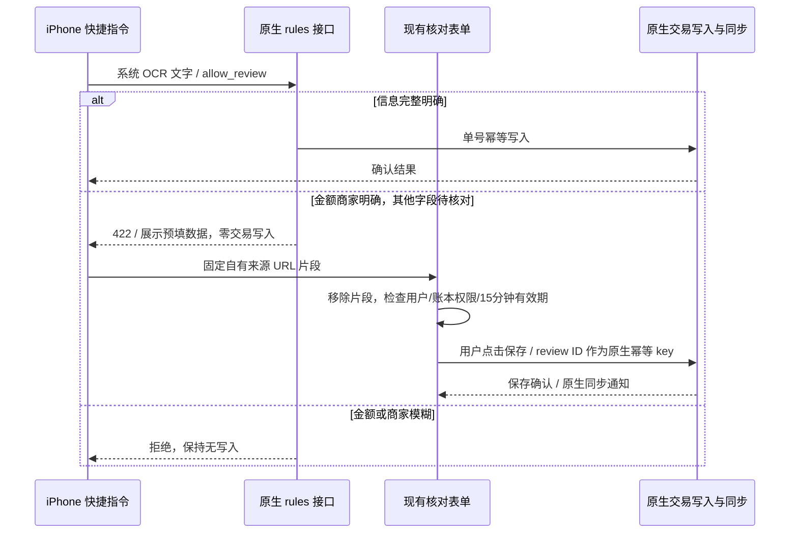

# BeeCount Cloud 同步架构与核心路由总览

本文档描述 BeeCount Cloud(server 端)的同步机制、核心路由分工、数据流
走向,以及最容易踩坑的几处契约。**改动 `src/routers/sync/` / `src/routers/write/`
/ `src/sync_applier.py` / `src/routers/ws.py` 之前请先读完"核心契约"一节。**

2026-04-21 一次 refactor 之后这些代码按路由拆成了包(`write/`, `read/`,
`sync/`),业务核心(`apply_change_to_projection`)进一步抽到 `src/sync_applier.py`。
本文档是拆分之后的地图。

---

## 1. 架构总览

三方:**Mobile App**(Flutter)、**Web 面板**(React)、**Server**(FastAPI + SQLite/Postgres)。

Server 端的存储分两层:

- **Event log**:`sync_changes` 表。不可变的增量事件流,每条写入顺序编号
  `change_id`。保留用于 pull 增量同步的源头。
- **Projection**:`read_tx_projection` / `read_account_projection` /
  `read_category_projection` / `read_tag_projection` / `read_budget_projection`
  五张 denormalized 表。读路径(`/read/*`)直接查这些,不用回 event log
  重放。写路径的 LWW / rename cascade 等规则都落在这里。

**历史上还有 `ledger_snapshot`**(JSON blob)作为聚合源,但方案 B
(projection-as-authority)之后:
- /sync/push 不再写 ledger_snapshot 行
- /read/* 全部从 projection 读
- /sync/full 按需从 projection 懒构建 snapshot(供 mobile 首次同步 / 重装)

这个过渡导致一些历史代码路径看着还在处理 snapshot,但生产上用不上。
新代码不应该再主动写 ledger_snapshot。

---

## 2. 目录总览

```
src/
  routers/
    sync/               ─ mobile ↔ server 双向增量同步的 HTTP 接口
      __init__.py        包入口,re-export router
      _shared.py         共享 imports + _to_utc / _max_cursor_for_ledgers + router 实例
      push.py            POST /sync/push         mobile 推送本地变更(批量)
      pull.py            GET  /sync/pull         按 cursor 增量拉取(mobile + web 掉线补)
      full.py            GET  /sync/full         按需构建并返回账本完整 snapshot
      ledgers.py         GET  /sync/ledgers      列出 caller 可访问账本元信息

    write/              ─ web 面板的写入接口
      __init__.py        包入口
      _shared.py         _commit_write 写入引擎 + idempotency + rename cascade + normalize 等
      ledgers.py         POST/PATCH/DELETE /ledgers
      transactions.py    POST/PATCH/DELETE /ledgers/{id}/transactions
      accounts.py        同上 /accounts
      categories.py      同上 /categories
      tags.py            同上 /tags
      # budget 暂时只走 /sync/push,没有 web /write 端点

    read/               ─ 读路径(mobile 和 web 都用)
      __init__.py        包入口
      _shared.py         ledger 可见性 / owner 回填 / snapshot_cache / 字段映射
      ledgers.py         /ledgers 及 /ledgers/{id}/* 账本维度读
      workspace.py       /workspace/* 跨账本聚合读
      summary.py         /summary 用户总览

    ws.py                WebSocket 路由:server → 客户端的实时推送

  sync_applier.py       ─ 纯业务:一条 SyncChange 怎么落到 projection
                         apply_change_to_projection 被 /sync/push 消费;
                         未来 backup restore / replay 也会用

  snapshot_builder.py   按需从 projection 构建 /sync/full 的 snapshot
  snapshot_cache.py     短 TTL 内存缓存 /sync/full 结果
  snapshot_mutator.py   /write/* 的 snapshot mutation helper(历史遗留,仍在使用)
  projection.py         projection 表的 upsert/delete/rename_cascade 低层 SQL
```

---

## 3. 数据流

下面四条是双向同步的核心路径。修代码前想清楚自己在动哪一条。

### 3.1 Mobile 写入 → Web 可见

```
用户在 mobile 改交易
  ├─ Flutter LocalRepository 写本地 SQLite
  └─ ChangeTracker 记一条 local_changes 行(待推)
                              │
                              ▼
  自动 sync 触发(app 生命周期 / 用户手动 / 周期性)
                              │
  POST /api/v1/sync/push   ◄──┘
  batch: [...changes]
                              │
  src/routers/sync/push.py    │
  ┌─────────────────────────▼──────────────────────────────┐
  │ 单个 change 处理:                                        │
  │   1. LWW 检查:比 (updated_at, device_id) 跟已有最新 change │
  │      - 输:跳过;平:idempotent replay;赢:继续            │
  │   2. INSERT 一条 sync_changes 行(自增 change_id)         │
  │   3. sync_applier.apply_change_to_projection(change)     │
  │      ├─ ledger: 更新 Ledger 表 name/currency             │
  │      ├─ delete: projection.delete_* + GC 孤立附件         │
  │      └─ upsert:                                          │
  │          a. rename cascade 探测(account/category/tag 改名)│
  │             (exchange_rate_override 无 rename-cascade、无共享账本扇出)
  │          b. _merge_with_existing 拉现有行把 None 字段补齐  │
  │          c. projection.upsert_* 写行(同事务)             │
  │ 整批单事务 commit                                        │
  └──────────────────────────────────────────────────────────┘
                              │
  commit 后 WebSocket 广播(src/routers/ws.py):
                              │
  web 端 SyncSocketContext 收到 sync_change 事件
                              │
  各 Page 的 useSyncRefresh 触发 /read/* 重拉
                              │
  用户看到新数据
```

### 3.2 Web 写入 → Mobile 可见

```
用户在 web 面板改交易
  │
  POST /api/v1/write/ledgers/{id}/transactions
  │
  src/routers/write/transactions.py
  │
  ┌─────────────────────────▼──────────────────────────────┐
  │ _commit_write(write/_shared.py)                         │
  │   1. 加载当前 snapshot(snapshot_mutator.ensure_snapshot_v2)│
  │   2. mutate lambda 改 snapshot 对应 array               │
  │   3. diff prev vs next → _diff_entity_list              │
  │      为每条 diff 写一行 sync_changes(tx / cascade 可批量) │
  │      同时 projection.upsert_* / delete_*                │
  │   4. idempotency key 写入(sync_push_idempotency 表)     │
  │   5. commit                                             │
  └──────────────────────────────────────────────────────────┘
                              │
  commit 后 WebSocket 广播
                              │
  mobile 端 useSyncSocket 收到 sync_change
                              │
  触发 SyncEngine._pull(ledgerId):
    GET /api/v1/sync/pull?since=<cursor>&device_id=<my-device>
                              │
  src/routers/sync/pull.py 返回 since 以来所有 change
    (过滤掉 updated_by_device_id = 自己 device 的)
                              │
  mobile 应用到本地 SQLite,UI 自动刷新
```

### 3.3 Mobile 首次同步或重装

```
mobile 登录 / 换设备 / 清缓存重装
  │
  GET /api/v1/sync/ledgers              列出可访问账本
  GET /api/v1/sync/full?path=<ledger>   每个账本拉完整 snapshot
                              │
  src/routers/sync/full.py
  │
  snapshot_builder.build_snapshot(db, ledger) ← 从 projection 现场构建
  snapshot_cache 内存缓存(短 TTL,减少重复构建开销)
                              │
  mobile 把 snapshot.items / accounts / categories / tags / budgets
  整份写到本地 SQLite(伴随本地 id ↔ sync_id 映射)
                              │
  以后 GET /sync/pull?since=<cursor> 增量拉
```

### 3.4 Web 读

```
Web Page mount / useSyncRefresh 触发
  │
  GET /api/v1/read/workspace/accounts (或别的 /read/* 端点)
  │
  src/routers/read/workspace.py
  │
  查 read_*_projection 表做 SQL 聚合 + 跨账本 dedup + owner 回填
  不经过 snapshot / sync_changes
  │
  返回 JSON
```

---

## 4. 核心契约(最容易踩坑的)

### 4.1 user-global 实体 vs ledger-scoped 实体

**Mobile 端** `local_changes.ledger_id` 的含义有两种(具体见 mobile 仓
`CLAUDE.md`):

| Entity | Scope | `local_changes.ledger_id` | Server `sync_changes.ledger_id` |
|---|---|---|---|
| account | user-global | **必须** `0`,走 globalChanges 通道 | 随 push 挂到具体账本下 |
| category | user-global | **必须** `0` | 同上 |
| tag | user-global | **必须** `0` | 同上 |
| exchange_rate_override | user-global | **必须** `0` | 同上(无 rename-cascade、无共享账本扇出) |
| transaction | ledger-scoped | 具体 ledger.id | 具体 ledger.id |
| budget | ledger-scoped | 具体 ledger.id | 具体 ledger.id |
| ledger | 自身 | 自己的 id | 自己的 id |

**Mobile 侧出错过一次**:`updateAccount` 历史上用 `ledgerId: account.ledgerId`
(不是 0),sync_engine 的 `_push()` 查询漏掉,rename 永远卡本地。2026-04
修复改成 `ledgerId: 0`,并加了 `ChangeTracker.recordUserGlobalChange` / 
`recordLedgerChange` 两个 API 强制分流(见 mobile 仓)。

**Server 侧**不区分这两种 scope —— sync_changes 表每条都绑一个具体 ledger_id,
即使 entity 是 user-global(push 时 mobile 挂在 active ledger 下)。Server
只按 entity_sync_id 做 projection 去重。

### 4.2 LWW 冲突决胜

`sync/push.py` 里每条进来的 change 先查现有最新同 `(entity_type, entity_sync_id)` 
的 sync_changes 行,比较 **(updated_at, device_id)** 两元组:

- 入侵 < 存在 → 拒绝,记 `sync.push.conflict` + AuditLog,不写新行
- 入侵 = 存在 → 幂等回放,跳过
- 入侵 > 存在 → 接受

`device_id` 作为 tiebreaker 是为了让两台服务器 / 重试调用得出确定性结果。

**时钟偏移防御**:入侵 `updated_at` 会被 clamp 到 `server_now + 5s`,防止
mobile 本地时钟错乱一直赢 LWW。

### 4.3 Idempotency key(仅 write path)

Web `/write/*` 的 `_commit_write` 接受客户端传来的 `Idempotency-Key` 头。
同 key + 同 payload hash 重复请求直接返回上次的响应,不重放写入。存储在
`sync_push_idempotency` 表,24 小时过期,每次写入顺手清一次过期条目。

mobile `/sync/push` 走 LWW + (updated_at, device_id) 的幂等,**不**用这个
idempotency key 机制。

### 4.4 rename cascade

account / category / tag 改名时,`ReadTxProjection` 里的 denormalized 列
(`account_name` / `category_name` / `tags_csv` 等)也要刷,不然 web 看
tx 列表的账户名永远是旧的。

- **/sync/push 路径**:`sync_applier._detect_and_run_rename_cascade` 在
  upsert *之前* 跑(upsert 之后 projection 里就只有新名,没法按旧名 match)。
- **/write/* 路径**:`write/_shared.py::_diff_entity_list` + `_collect_renames`
  处理。更进一步的优化是 `_tx_diff_only_cascade`:当 tx 的 diff 只在
  cascade 字段上(账户/分类改名触发的 denorm 更新),绕开 per-row projection
  upsert,改成一条 SQL UPDATE + 一条 SyncChange bulk insert,10k tx 的
  rename 从 10k 次 ON CONFLICT 降到 1 条 UPDATE。

### 4.5 增量 push 的字段 merge

Mobile `/sync/push` 发来的 payload 可能**只带改的字段**(比如只改 name,
其它字段是 None / 缺失)。不能直接 upsert,否则其它字段会被默认值覆盖。

`sync_applier.merge_with_existing()` 先查现有 projection 行,用旧值补齐
payload 缺失 / None 的字段,再 upsert。

**踩过一次坑**:老代码是 5 个 `_merge_with_existing_<entity>` 函数 copy-paste,
budget 那个函数体内的 `from .models import` 相对路径写错,/sync/push 带
budget 时 500 `ModuleNotFoundError`。现在合并成表驱动的 `_MERGE_SPECS` +
一个 `merge_with_existing`,新增 entity 只加一条 spec,不可能再漏 import
或复制粘贴错字段。

**transaction 的 merge 有一个 per-entity 后处理特例**
(`_sync_native_amount_after_merge`,交易级多币种 0018):payload 带新
`amount` 但不带 `nativeAmount`(旧客户端只知道原币金额)时,merge 从
existing 补回的旧 `nativeAmount` 会与新 amount 失配 → 后处理按该笔隐含
汇率联动(同币种跟随 / 外币等比缩放)。Web 写路径的对应联动在
`snapshot_mutator.update_transaction` 的 amount 分支(L14)。两处逻辑
必须保持一致 —— 改一处记得看另一处。

### 4.6 change_id 单调性

`sync_changes.change_id` 是 autoincrement,**严格全局递增**。

- mobile pull 按 `since=<last_cursor>` 拉:cursor 保存在客户端,server
  只返回 `change_id > cursor` 的行
- web 的 `Idempotency-Key` 失败时响应里会带 `latest_change_id`,客户端据此
  决定要不要 refetch

**不要手工 update change_id** 或改成非 autoincrement 的逻辑。

### 4.7 lock_ledger_for_materialize

`/sync/push` 和 `/write/*` 应用 projection 之前都调这个 SQLite advisory lock
按账本加锁,避免两个并发 push 同账本的 rename cascade 交错。

锁粒度是 ledger,不阻塞跨账本并发写。

---

## 5. WebSocket 实时推送

`src/routers/ws.py` 很薄,就是把 WS 连接丢到 `websocket_manager` 的 per-user
注册表里。server 这边不主动检测变化;每次 `_commit_write` 或 /sync/push
commit 完事之后,在 HTTP handler 里 explicitly 调 `websocket_manager.broadcast`
推 `{"type": "sync_change", ...}` 或 `{"type": "profile_change", ...}` 到该 user
的所有活跃连接。

客户端不用 WS 事件直接更新数据,只用它作为"去 pull 一下"的触发信号:
- Mobile: `useSyncSocket` → `_pull(ledgerId)` 增量拉 sync_changes
- Web: `SyncSocketContext` → `useSyncRefresh` 调各 Page 的 refetch

如果 WS 掉线没收到事件,还有 polling fallback(mobile 的 `startPoller` +
web 的 `SyncSocketProvider` 里的 poller)每 30s 主动拉一次补漏。

---

## 6. 常见 debug 路径

### "Mobile 改了数据,web 刷新看不到"

1. **server log 搜 `sync.push.accept`**:确认 push 真到了 server 并被接受
   - 如果有 `sync.push.conflict` 说明 LWW 拒了(通常是 device clock 问题)
   - 如果连 push 请求日志都没有,问题在 mobile 端(本地没推出去)
2. **查 sync_changes 表**:`SELECT * FROM sync_changes WHERE entity_sync_id = '<x>' ORDER BY change_id DESC`
3. **查 projection 表**:`SELECT * FROM read_account_projection WHERE sync_id = '<x>'`
4. **多账本场景特判**:一个 user-global 实体在多个账本的 projection 里都有
   行,现在 list_workspace_accounts 的 dedup 用 `source_change_id` 做
   tiebreaker(不是账本整体 change_id),应该没问题 —— 但新 API 加 dedup
   时要注意这个陷阱。

### "/sync/push 批量 500"

近期加了 try/except 包 apply_change_to_projection,炸哪条会打
`sync.push.apply_failed entity=... sync_id=... payload=...` 加完整 traceback。
直接看终端或管理员日志面板搜 request_id 即可定位。

### "web 写入返回 409 WRITE_CONFLICT"

客户端的 `base_change_id` 落后于 server。两种情况:
- 正常:用户在 web A 改交易同时 mobile 推了 change(多端并发)→ 客户端
  手动交易编辑不能直接更换版本重试；保留草稿，让用户核对最新交易（见第 9 节）。
- 异常:`STRICT_BASE_CHANGE_ID` 环境变量打开了(默认关),导致严格比对
  latest change_id

### "mobile 看不到 web 刚改的数据"

1. WS 连接是否活跃?(检查 mobile log `[SyncEngine] WS connected`)
2. `/sync/pull?since=<cursor>` 手动调一下看返回啥
3. `sync_changes.updated_by_device_id`:注意 server 会过滤掉自己 device id
   的 change(避免自己 push 的再被 pull 回来)

---

## 7. 修改这块代码之前的自检清单

- [ ] 改的是哪条路由的逻辑?对应文件是?
  (写入:`routers/write/{entity}.py`;推送:`routers/sync/push.py`;等)
- [ ] 是改共享 helper 还是单 endpoint 行为?前者去 `_shared.py`,后者去对应 entity 文件。
- [ ] 牵涉到 user-global 实体(account/category/tag/exchange_rate_override)吗?ledger_id=0 通道?
- [ ] 有没有新增 entity type?`_MERGE_SPECS` / `_UPSERT_DISPATCH` / 
  `_DELETE_DISPATCH`(在 `sync_applier.py`)三张表都登记了?
- [ ] 改了 payload 字段映射?对应的 spec 加了字段,并且 **mobile 端 /
  web 前端** 也理解这个新字段吗?
- [ ] 跑了 `pytest tests/` 吗?projection 一致性测试全绿?
- [ ] 多账本场景想过吗?单账本能跑不代表多账本不出问题。

---

## 8. 不在本文档范围

2026-10-15 定向适配：`routers/ws.py` 的建连用户查询在线程池中打开和关闭原生 Session，避免连接池 checkout 等待阻塞事件循环。池超时拒绝临时握手（1013），不改变 JWT scope、用户存在性校验、ping/pong 或同步事件格式。`tests/test_ws_pool_pressure.py` 用真实耗尽的单连接池验证事件循环仍可运行，并核对正常连接释放数据库连接及心跳。

- Auth / JWT / refresh token 流程:见 `src/routers/auth.py` 和
  `src/security.py`
- Profile / 头像上传 / AI config 同步:`src/routers/profile.py`
- 管理员用户 / 设备 / 备份 / 健康:`src/routers/admin.py`
- Attachment 上传 / 下载 / 缩略图:`src/routers/attachments.py`

这些都不参与业务数据的 LWW 同步,逻辑相对独立。

## 9. 拾账 Web 手动交易保存（2026-10-17）

`TransactionsPage` 与 `GlobalEditDialogs` 复用 `useManualTxWrite` / `ManualTxWriter`，原生认证、交易写入、Idempotency-Key、change log 和 WS 扇出保持沿用。

保存前读取工作区状态；编辑表单打开时捕获交易的 `entry_change_id`，请求以可选 `expected_change_id` 提交。工作区的逐笔版本来自 projection 的 `source_change_id`，与既有表示账本头的 `last_change_id` 分开。写入 worker 在原事务内通过 `(ledger_id, sync_id, source_change_id)` 条件 UPDATE 校验并锁定目标行；失配回滚并返回 409。幂等记录命中先于此校验，所以已提交请求的原 key 回放不被自身版本更新拒绝。新增字段可选，无数据库迁移；旧客户端未带 guard 的行为不因此改变。

首次请求前将不可变的正文、key、base、时间写入按用户及 API 地址隔离的 sessionStorage；存储失败不发写入。等待超时、网络失败、5xx 或响应解析失败可能发生在提交之后，此时保存待核对请求、锁定表单，不自动重试。用户选择“核对并完成本次保存”时发送完全相同的请求；服务端原生幂等回放或完成原写入，不生成新 key。服务端原生保留期 24 小时，客户端保守限制 23 小时；过期或本机时间倒退不自动写入。刷新同标签页可恢复；跨标签页/设备和清除存储没有保证，没有离线写入队列。

初次明确业务拒绝保留草稿，旧版本冲突不得通过换新 base 自动覆盖。已确认成功后的刷新失败也不得变成“可再新增一笔”。账户、分类等字典按账本/请求序号隔离，晚到的旧响应不会覆盖新账本选择。

写入公共 helper 的三个 worker 提交后在 worker 内刷新 ledger/user，避免 ORM 属性过期后在 ASGI 事件循环执行连接 checkout；池耗尽等待仍由 worker 承担。`tests/test_manual_pool_responsiveness.py` 用受限真实连接池和 16 并发原生请求验证，不通过调大池掩盖阻塞。`tests/test_manual_tx_revision.py` 验证旧版本拒绝、原请求回放及无关交易更新。

本轮逐笔条件写入验证数据库为 SQLite；PostgreSQL 与未带 guard 的原生 TestFlight 客户端不在通过范围。结果与发布证据见 `G:/skill/personal-ledger/beecount-evaluation/MANUAL-ENTRY.md`。

## 10. 手机录入便利与可见连接状态（2026-10-17）

`useManualTxWrite` 仅在新建或恢复新建确认成功后，记录按 API 地址、用户、账本、收支类型隔离的本机偏好：上次账户与最多三个最近分类。新建时只在字典加载完成且名称唯一、账户未隐藏时沿用；分类仍由用户点选，编辑历史账和转账不应用这一默认。账户置空不会被同一次表单重渲染重新填回。存储不可用不影响已确认的保存结果；这不是云端偏好同步。

手动保存的两个准备读取各有 15 秒等待上限，超时不会写入；晚到结果不会恢复已经停止的保存流程。读取底层请求可能继续结束，但不会因此发送写请求。提交后的未知结果仍走第 9 节原请求恢复。

`SyncSocketProvider` 对外提供连接、网络、拉取结果与最近完成核对时间。`drainPull` 复用 API client 已有 single-flight 会话续期，逐请求 15 秒 AbortSignal；`complete=false` 区分 HTTP 拒绝、断网、无效分页和轮次上限。已取得并推进 cursor 的分页，即使下一页失败仍交给订阅页面，不能丢弃这些变更。共享 HTTP 客户端保留最终 401 可解析的响应；续期成功后的请求网络失败不再触发注销。

重连、窗口恢复可见、网络恢复或用户“重新核对”复用既有 poller 的单次拉取锁；完整核对后即使没有新 change，也通知页面刷新，补足漏掉的推送。WebSocket 旧实例的迟到帧不会影响新实例；心跳超时先清理旧实例及定时器再重连。错误、离线、登录失效和正在核对分别显示，连接正常不等于每个页面已刷新或某次保存成功；保存确认仍由交易写入控制器负责。

PWA 更新提示位于主内容流，避免覆盖账本选择器；仍需用户明确点击更新才允许刷新页面。手机记账弹窗打开时聚焦标题，保留系统缩放；金额输入在前，类型为普通按下态按钮，其他选项保留原组件。浏览器的可用区域/短窗口验证不代表 iPhone 软键盘和 safe area 已验收。证据见 `G:/skill/personal-ledger/beecount-evaluation/MOBILE-ENTRY.md`。

## 11. 公共输入与可见视口（2026-10-17）

AppShell 复用 `observeDialogViewport`，通过 `observeEditingViewport` 在焦点、输入、可见视口 resize/scroll 和适用的元素尺寸变化后核对当前字段。两次 animation frame 后按可见视口和祖先裁切计算需要的原生滚动；不修改值、选择区或焦点。弹窗只滚动自身容器；普通页面额外考虑应用头部和底部导航。显式放大、只读字段和宽桌面正常视口不接管。小高度记账弹窗可整体滚动，避免固定头尾消耗全部内容区。Login 不在此次 AppShell 处理范围。

轻点期间收到的键盘 resize 保留至松手重新测量，覆盖已聚焦字段再次点入而不产生 focusin/input 的场景；移动超过 8px 或取消手势不补做焦点滚动，尊重手动浏览。观察器卸载时清理监听、帧、尺寸观察及根属性。浏览器合成视口/手势通过不等于 iPhone 键盘验收，用户此前仍报告需要打字后才显示，最新真机结果待确认。证据与部署状态见 `G:/skill/personal-ledger/beecount-evaluation/INPUT-FOCUS.md`。

## 12. 累计记账日期与日历跨度（2026-10-17）

`/read/workspace/ledger-counts` 接受与 analytics 一致的可选 `tz_offset_minutes`（-720..840，默认 0）。`distinct_days` 按记录时间加客户端偏移后去重日期；`days_since_first_tx` 按同一偏移下的今天与首笔日期差加 1。记录的 `first_tx_at` 保持原 UTC 时间，存储、交易写入和权限范围不改变。Web 首页和年度报告读取传浏览器偏移，旧客户端未传仍为 UTC。

首页“记账天数”显示有记录的日期数；平均每天笔数继续按首笔至今的日历跨度计算，并在脚注注明，两者不互换。统计排除只影响原生收支/预算口径，不会使真实账户变动消失；CSV 仍是原生交易明细格式，不是完整统计元数据或附件备份。原生隔离生命周期、跨日/跨月、多币种及桌面导出证据见 `G:/skill/personal-ledger/beecount-evaluation/ACCOUNTING-CONSISTENCY.md`。

## 13. PWA 更新状态与可选模型入口（2026-10-17）

`setupServiceWorkerUpdates` 对 waiting/installing worker 的状态变化及 controllerchange 发出统一状态通知；`PwaUpdateBanner` 每次重读当前 installed waiting 状态，防止其他窗口完成更新后留下失效提示。本窗口未接受更新时 controllerchange 不刷新表单；明确接受后只刷新一次。返回清理函数移除监听、定时器及已观察的 worker。受控事件验证与公网实际接受更新分别记录，不将前者冒称真实双窗口集成。

`ParseTxDialog` 的初始 OCR 文字只走明确的 rules；图片弹窗先展示上传目的地与费用提示，显式点击才调用现有 `parseTxImage`。文字 AI 需选择引擎并点击发送，规则失败不自动降级到模型。这里没有新增模型代理、识别模型、账户或额度服务。原生认证与交易草稿核对/保存复用既有链路。

原生备份实现未改；补充合成非空附件的原生上传、交易引用、加密恢复及下载权限集成测试。相关 21 项禁网同镜像检查通过，但同路径恢复不代表不同附件根路径迁移或实际停服切换完成。见 `G:/skill/personal-ledger/beecount-evaluation/PWA-RELIABILITY.md` 与 `RESTORE-DRILL.md`。

## 14. OCR 采集到原生核对保存（2026-10-17）

v3 快捷指令复用 iPhone 截图和系统 OCR，向原生 rules 记账接口明确传 `allow_review:true`。金额/商家模糊仍拒绝；金额/商家明确但单号、时间、账户或默认分类不能满足自动入账时，接口返回 422 和受限的展示预填数据，不写业务数据。完整且明确的单据继续原生单号幂等自动写入。只在明确实付字段兼容已观察到的 `* 0.01`、`· 0.01`，不普遍修复模糊金额。



预填片段不含密码、JWT、原始 OCR，也不是可信授权凭据。`main.tsx` 在登录路由前捕获并移除片段；受限字段暂存当前标签页，当前用户与目标账本可编辑权限确认后，复用 `GlobalEditDialogs`。缺失时间/账户保持空、不会套用最近账户。原生写入继续检查身份、权限与字段；不新建草稿表、评论设施或认证系统。

同一次 review 的 request key 复用第 9 节原生恢复流程；未知结果不能改 key 重新创建。不同采集生成不同 review ID，缺少交易单号时不能跨次去重。用户本次多次运行并保存产生三笔相同合成样例，服务器三个独立 key 与分次时间、桌面自动同步已核对，不能称单次保存幂等真机验收。疑似重复提醒仍待补，不能仅凭相同金额/商家合并可能真实的两笔消费。

证据见 `G:/skill/personal-ledger/beecount-evaluation/OCR-REVIEW.md`。iPhone 合成样例核对链路已通过，不覆盖真实各类付款布局、公共软键盘焦点或多用户模板配置。

## 15. v4 主动触发身份与原生选项（2026-10-17）

用户明确每次主动触发可以是另一笔真实消费；无单号不应阻止入账，相似金额/商家不得自动合并或删除。`RecordOcrTextRequest` 增加可选 request_id（20..100位受限字符串），以及本次明确选中的 account_id/category_id。新 v4 在原生截图/OCR 后生成四个随机数、只 hash 一次；初次请求与需要补账户/分类后的第二次请求都引用同一 hash。新的主动运行生成新的编号，不按账单内容生成它。旧版未传 request_id 继续第14节原行为。

新模式不再以订单号作为自动写入前提；明确金额/商家、时间/新鲜度与现有字典检查保持。原生幂等 key 来自账本和 `run:request_id` 的摘要，在既有 user/device/key 域内回放；同 key 更改实际入账字段返回409，两个新编号即使订单相同也保留两笔。没有新增防重表或自动账目合并。

仅账户/分类不匹配时返回422和 shortcut_choices（summary、供显示的 labels、label→同步ID映射及已匹配ID），同时可保留旧网页回退。所有选项在已授权账本拥有者的已有人民币可用账户/叶子支出分类内；同名项显式标识ID，不静默选一个。v4 用两个现成 chooseFromList 动作只询问缺项，再提交原文、同一 request_id 和明确选择。服务端重新查当前用户权限及字典归属、可用性/币种/类型；选项不是授权凭据，不改默认偏好，也没有额外交易草稿服务。

复杂缺项、时间缺失/过旧继续第14节网页核对；模糊金额/商家等拒绝。网络未知不自动重试，跨运行没有持久化恢复队列；重新运行是新意图而可能再记一笔，必须先核对结果。部署与测试范围见 `G:/skill/personal-ledger/beecount-evaluation/OCR-TRIGGER.md`，v4 物理手机结果单独记录，不复用 v3 已通过结论。

后续真机确认：v4 一笔真实付款直接入账、未打开网页，用户核对金额/账户/时间正确；原生来源与8→9读回一致，其他分支不自动升级。`ocr-service-20261017` 仅在负向状态扫描中排除明确“账单服务”分节内独占行“申请退款”动作，保留其他行以及真实退款/失败/转账拒绝，不删整个页脚。相关123项原生回归通过；此独立修复不能证明就是用户此前失败页面的原因，样例商家漏识别仍未复现。见 `G:/skill/personal-ledger/beecount-evaluation/OCR-SERVICE.md`。

## 16. v5 结果页、缺失时间与明确确认（2026-10-17）

`payment_rules` 仅规范化独占成功标题的字间空白。无标签结果后备版式要求唯一成功标题、带掩码收款人、明确人民币金额与后续完成动作，返回 `receipt_kind=payment_result`；收款人只作预填备注，账户/时间/订单维持缺失。实际 iOS OCR 输出未取得，照片匿名文字重放不冒称真机提取。

原请求模型增可选带时区 captured_at、confirm_capture_time、confirm_result_expense。v5 在截图前捕获一次ISO时间，重用同一时间和request_id；缺付款时间时仅可将前后5分钟内的捕获时间作候选，未明确确认则返回422和原生确认信息，零交易写入。结果页另要求确认按支出记录；即使已有账户/类别，缺该确认仍不能自动写入。已有付款时间永不被捕获时间覆盖，naive/过旧时间不作候选。

选择信息包含 confirmation_required，v5 将其转为数字比较1，原生带取消按钮的确认在字典选择和第二次请求之前；取消即停止，不发送第二次写入。确认后选实际账户及类别，以原request_id、原captured_at和明确布尔确认沿用既有写入/幂等。未传捕获时间的旧版遇到缺时间仍网页核对，完整旧路径兼容；无新草稿表或认证边界。详细检查、证据与手机待验项见 `G:/skill/personal-ledger/beecount-evaluation/OCR-RESULT.md`。

## 17. v6 简版结果页默认提交时间（2026-10-17）

用户要求简版付款成功页采用本次提交时间，详细账单/手动入口保底。请求新增可选 `result_time_policy`（默认 `confirm_capture`，或显式 `submission`）、带时区 `submitted_at`。仅 `receipt_kind=payment_result` 且有request_id、没有真实付款时间时，新策略采用前后五分钟内的submitted_at，不额外要求时间或支出确认。其他版式和明确付款时间保持原规则，无时区、缺失或过旧提交时间不自动写入。账户/类别及身份、权限、可用性、币种仍重新检查。

v6截图/OCR后登录，在首次入账POST前取一次手机ISO时间；两个入账动作引用同一submitted_at和每次运行的request_id，不因原生选项或重发而改变。提交时间不是服务端最终事务时间，不能还原旧账付款时间；不同主动运行仍可记两笔，不按内容合并。旧v5默认明确确认策略兼容，沿原生写入/幂等/同步，无新持久化设施。

142项隔离后端回归与公网普通账号无交易写入核对通过，v6真机尚未通过；用户报告v5系统“请求失败”，只读日志可见手机登录200和入账422，不足以定位具体动作。v6默认规则调整不冒称该错误已修复。证据和回退见 `G:/skill/personal-ledger/beecount-evaluation/OCR-SUBMIT.md`。

## 18. 请求时区定位与v7扫码付款兼容（2026-10-17）

原生RequestValidationError的通用提示在截图中得到确认。RecordOcrTextRequest的wrap校验仅记录本模型字段名/Pydantic错误类型，并重抛原异常，不记录input/context或账单/凭据；成功请求不记拒绝日志。用户触发后读到captured_at/timezone_aware，确认v5手机采集时间缺时区。v5/v6原动作ISO样式带TimeFormatStyle=None；v7改明确Custom `yyyy-MM-dd'T'HH:mm:ssXXX`，两个入账请求仍引用首次提交前的一次完整手机时间。服务端AwareDatetime不放宽；v7实际格式输出和OCR待真机。

解析层另仅在唯一明确扫码付款标题、唯一负号金额、当前状态支付成功同时成立时，允许行首“转账时间/转账单号”作为付款元数据。真实转账/退款内容仍保留拒绝，其他金额商家及权限约束不变。匿名QR两种布局红绿重放、155项后端回归、公网普通账号无写入核对通过，不冒称实际iPhoneOCR。见 `G:/skill/personal-ledger/beecount-evaluation/OCR-CLOCK.md`。

## 19. v7 状态行与完整双列表（2026-10-17）

手机v7请求越过模型校验，但解析被负向词“转账”拒绝。结构计数（无正文/数值）为扫码标题1/负号金额1/相邻状态匹配0/成功状态1/当前状态字段1；不能因此还原实际OCR全文。仅在唯一QR标题/负号金额下，解析器兼容完整已知五字段左列后跟状态、备注、账户、日期、单号右列的布局，要求已知字段顺序和日期/单号形状，规范化后仍沿原字段解析；另规范化明确状态行的字间空格。未知列序、退款、真实转账仍拒绝。无新实体、写入或鉴权设施。

164项隔离后端回归、公网普通账号匿名两类布局与无写入核对通过，所有Web字节和原生签名v7保留；新规则手机实际保存待验，不能替代真机验收。见 `G:/skill/personal-ledger/beecount-evaluation/OCR-COLUMNS.md`。

## 20. 消费账单家族的负号与显示名（2026-10-17）

用户9张微信图按QR付款、普通账单、聊天/平台详情、充值、群收款和收到转账区分。当前仅补既有消费范围：账单/交易详情标记、唯一负号金额、唯一明确成功状态与付款时间满足时，把该受限负号作为支出幅度；没有显式商户字段的已验证交易详情，仅采用金额至首次状态字段之间唯一一行显示名。完整显式商户标签优先，不拼多行、不把余额或收单机构当交易金额/商家。既有权限、原生写入/幂等及12小时窗口保持，旧账走核对。

175项隔离后端回归、5类匿名公网预览及旧账核对通过，v7及Web字节保持；实际手机OCR、群收款/收入用途口径和本批未提供的支付宝图仍待补证，不扩大业务枚举或另建设施。见 `G:/skill/personal-ledger/beecount-evaluation/OCR-WECHAT-FAMILIES.md`。

## 21. 晚间回顾复用日历日详情（2026-10-17）

用户澄清只需大致回看，前述规范不重新打乱。CalendarPage沿既有日期筛选读接口返回的total展示当日记录总数，列表items最多200时另显示已显示/总数；不以items.length或净额推导条数。日读取加载/错误时不把旧数或空列表当确认结果。原日收支、单笔详情/编辑、OCR、写入/幂等、持久化状态不变，没有新增审核状态、确认实体或后台任务。

174项前端检查、tsc/build及390px隔离合成展示通过；公网limit=1的total与全量日期明细一致，线上日历显示当日6笔，原业务数据指纹保持。实际iPhone/OCR未因此升级为通过。证据见 `G:/skill/personal-ledger/beecount-evaluation/DAILY-GLANCE.md`。


## 22. 逐笔有符号金额展示（2026-10-17）

共享web-features的transactionAmountDisplay依原生有符号amount和tx_type计算展示方向：expense取相反资金方向，income保持，transfer为中性色且不添加收入正号。绝对幅度和唯一符号分开输出，显示零分时不显示方向。交易行、日历、详情、命令搜索和最近记录复用；折算快照按相同规则展示，不改变原始类型/金额、后端统计或CSV契约。没有建立退款实体或重建写入、同步/幂等设施。

原双负号由组件红绿回归复现，185项前端及类型构建通过，匿名320/390/820px组件验证和公网只读/资源/健康通过；正式库未写合成退款。原生代码、签名v7及既有待验保持，Web退款编辑入口不因此宣称完善。证据见G:/skill/personal-ledger/beecount-evaluation/AMOUNT-DIRECTION.md。


## 23. 个人往来只读核对预填（2026-10-17）

payment_rules限定收到转账（正号、明确到账）与群付款（负号、明确付款成功），返回personal_incoming/group_payment及原生类型方向和正金额幅度，不要求消费商户。保留实际收款/付款时间，未知项为空，不以余额/发起时间/当前时间补交易事实。完整已知表格列式可重建，不猜未知列序。

record-ocr-text对两类在既有自动写入之前强制返回review，payload version2携带tx_type/review_reason；旧v1-only客户端拒绝以防默认expense。新Web匹配reason与方向，空分类保留，类型只能原方向或transfer，切换保持对应账户端。review仍是同账号/账本/时效的非授权显示字段；显式Save走原生写入/幂等。个人review ID以user/ledger/request_id生成稳定UUID，同次回放不新建key，新主动触发不合并。没有新表、后台作业、认证或账务引擎。

194项禁网隔离原生后端、193项Web及类型构建通过；线上普通账号合成预填/相反方向拒绝、表单切换/取消、数据保持通过。签名v7不变，实际两类iPhone采集/保存待验。报告G:/skill/personal-ledger/beecount-evaluation/OCR-PERSONAL.md。


## 24. 原图基线与限定OCR文本恢复（2026-10-18）

原图仅在本机私有忽略目录，Windows内置OCR输出与真实期望不打包；公开回归使用匿名结构。控制字段/中文间距/日期标点规范化先保留字段边界；观察到“一”负号或两位中点金额、完整已知错列表格与唯一前置付款时间恢复均标layout_review。record在自动写入前强制返回既有v1消费核对，稳定layout命名空间key；个人v2原命名空间不变，正常消费原路径保留。商品未标文本不丢弃，失败/退款保护可继续拒绝，余额不作交易事实，不纠正专名或猜数字。

204项同镜像禁网原生回归及公网匿名接口/数据保持通过；Web/v7所有字节保持，本轮未重建浏览器UI。9张原图本机重放关键金额/方向/账户/时间全匹配，对方严格7张、2张需核对；不冒充实际iPhone或支付宝通过，支付宝待实际样本。细节G:/skill/personal-ledger/beecount-evaluation/OCR-CORPUS.md及PAYMENT-COVERAGE.md。


## 25. 原生交易回执核验与408保护（2026-10-18）

create/updateTransaction在原API边界校验原生回执的账本/交易ID、编辑目标、整数版本、时间戳和回放标记；异常200与传输结果未知一样保留ManualTxWriter原请求。HTTP408不按确定拒绝清除pending；显式recover仍用原body/base/key，不自动换版本或创建新意图。既有表单/原生幂等/鉴权/同步及微信解析器/v7不变，没有新增队列或账务设施。

205项Web/类型构建、206项隔离原生回归、390px合成恢复及线上无正式写入检查通过。微信个人往来核对保存验证了正负/同次回放/第二次意图条数和余额，实际iPhone与支付宝待验。详见G:/skill/personal-ledger/beecount-evaluation/WECHAT-STABILITY.md。


## 26. 先收下与持久稍后核对（2026-10-18）

用户不接受付款时即时核对，v8显式review_policy=deferred。临时导入cache/15分钟hash与标签不适合持久保存未知金额，故新增限定OcrCapture表，绑定本人/账本/主动request_id，原文不上模型，列表不含原文。正常清晰消费沿原直接写入；个人往来、恢复布局及其他缺项持久采集，明确金额/方向/时间/账户可先建原生记录、排除统计/预算，缺项只保留采集不造假账。原生create可选内部commit_hook同事务绑定capture/receipt，永久关联保护超出原生24小时缓存；完成核对校验已关联原交易及逐笔版本。

首页Inbox复用GlobalEditDialogs和ManualTxWriter；已记录PATCH，不再新建，未记账固定capture key创建，完成状态失败仍保留原请求。无新认证/记账引擎/调度器；普通明确消费不强制二审。v8只通知，无openURL/付款选择，v7兼容保留需一次换版。服务端9挂载/一张加法表，原数据卷保持。237项同镜像禁网原生含非空新表加密恢复、208项Web/类型构建、390px合成恢复和线上0笔基线保持通过；真实iPhone/OCR及支付宝待验。详见G:/skill/personal-ledger/beecount-evaluation/OCR-DEFERRED.md。


## 27. Optional vision fallback after OCR rules (2026-10-18)

The existing record-ocr-text endpoint accepts opt-in vision_fallback/image_base64 only with deferred policy and a per-run request ID. Authorization and ledger access precede any external call. Clear rules results keep the existing native write path without a model call. Uncertain rules results may use the current user’s native vision provider to transcribe a single transient JPEG/PNG; the result must pass the existing rules and cannot contradict readable amount/sign/time/funding evidence. Failed/refunded/foreign/overlay evidence is not rewritten by the model. Purpose uncertainty remains reviewable, independent of transcription.

No new auth, queue, model transport or schema is introduced. ai/payment_vision.py reuses provider_client with thinking disabled, bounded output/time and redacted errors. Final uncertainty uses the existing per-user capture table; a recovered clear draft freezes its exact native request in the same capture before native save. capture_write_guard commits its receipt and confirmed status in the same native transaction, allowing repeat submission without a second model call or extra transaction. Internal replay data is excluded from review display. Legacy default fields retain their prior request hash.

Signed Shortcut v9 sends local OCR and a metadata-stripped compressed JPEG only to the ledger server, never a model Key. Only unresolved captures are sent onward to the bound provider. Images are not persisted. Model failures do not trigger automatic write retries or browser review. Existing v8 stays text-only until replaced on the phone.

Evidence: 271 isolated native checks, 208 Web checks and build; synthetic connectivity succeeded, but actual receipt transcription acceptance remains pending due to free-provider HTTP429/1305 overload. No private corpus images were sent. Physical iPhone v9 import/upload/execution is pending. See personal-ledger/beecount-evaluation/OCR-VISION.md for deployment/readback boundaries.
